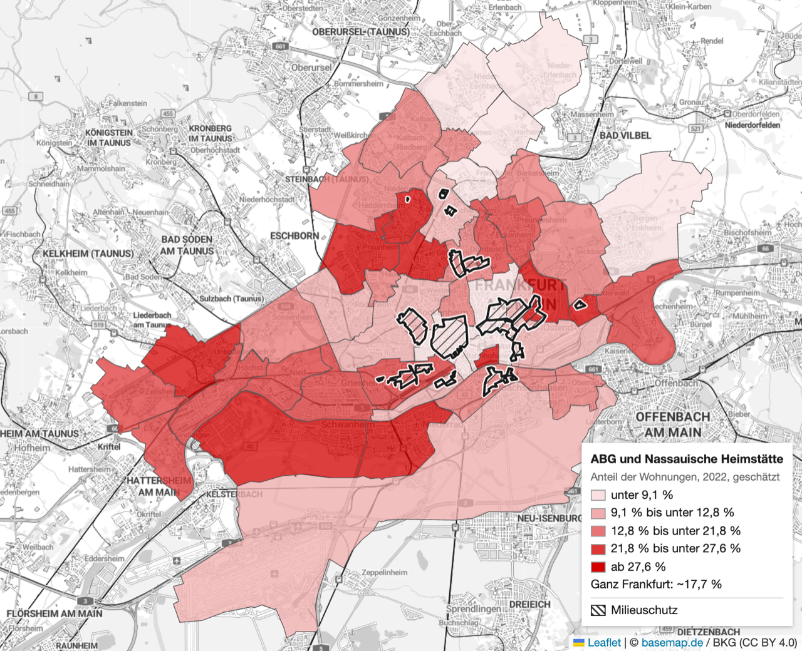
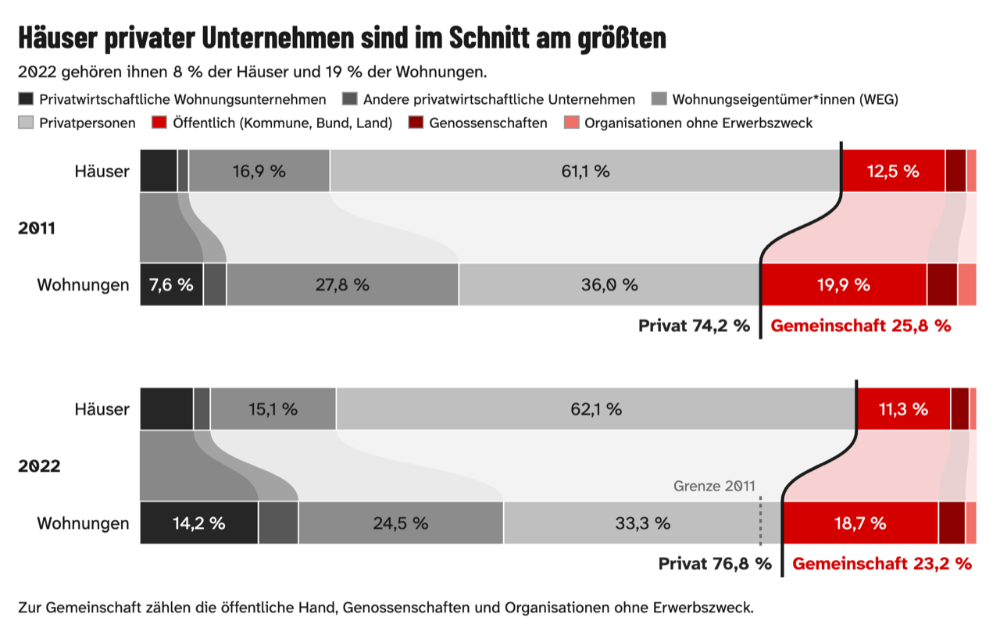
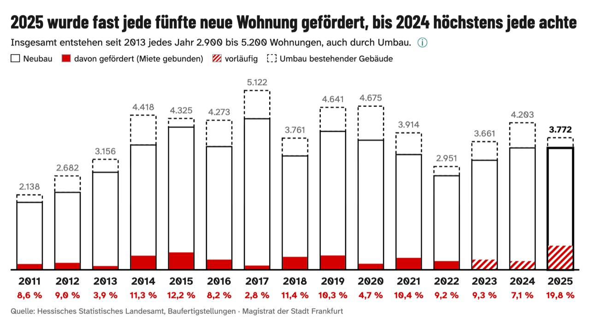
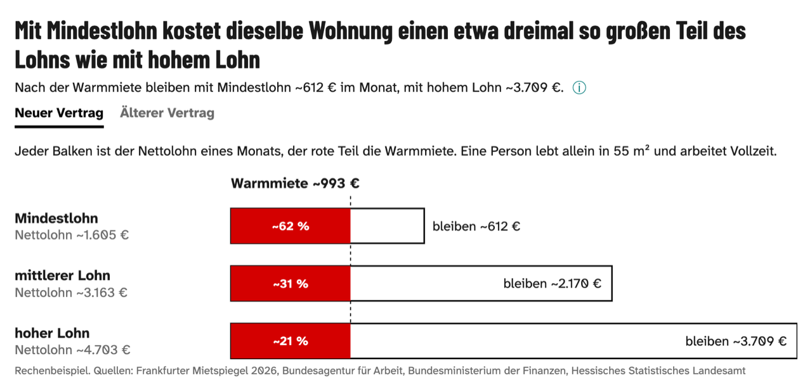

# Sozialraum Frankfurt

The web application Sozialraum Frankfurt is an interactive map that breaks down the areas of Frankfurt for a different
housing and climate policy. In addition, it shows how ownership changed, how many dwellings are built each year and
how much of a wage or an income the warm rent takes.

## Karte

The view Karte shows ownership, social situation, housing burden, land, protection and elections for each Stadtteil
and Bezirk.



## Trend

The view Trend compares the owners of houses and dwellings in 2011 and 2022.



## Neubau

The view Neubau shows the completed dwellings of each year since 2011 and the share of subsidised dwellings. Below
them, one block sets the rents of new and older contracts against prices and wages since 2017.



## Miete

The view Miete sets the warm rent against what people earn. A worked example shows the share of the net wage that the
same flat costs at the Mindestlohn, at the median wage and at a high wage, for new and older contracts in 2025.
Below it, the tenants of the survey Leben in Frankfurt 2024 and 2025 show their burden by household income.



## Status

Built for the Wohnentscheid Frankfurt, 2026. The map is online at
https://wohnentscheid-frankfurt.de/sozialraum-frankfurt/.

## Licence

- Code (`pipeline/`, `web/`, `tests/`, `research/scripts/`): MIT, see `LICENSE`.
- In `web/` the fonts Archivo and Mulish keep the SIL Open Font License 1.1 (`web/fonts/OFL-Archivo.txt`,
  `web/fonts/OFL-Mulish.txt`). Leaflet keeps BSD-2-Clause (`web/leaflet/LICENSE`).
- Own content (the built map, `docs/`, `research/` without its scripts, `reference/`):
  [CC BY 4.0](https://creativecommons.org/licenses/by/4.0/), Wohnentscheid Frankfurt.
- `sources/`: each file keeps the licence of its source; `sources/README.md` names it where known. Data under the
  Datenlizenz Deutschland (dl-de/by) require the name of the source.

## Build

```bash
uv venv --python 3.12 .venv && uv pip install --python .venv/bin/python -e '.[test]'   # once
(cd tests/browser && npm install && npx playwright install webkit)                     # once
.venv/bin/python -I -m pipeline.build                   # all steps, the map goes to output/
.venv/bin/python -I -m pipeline.build --step zensus     # one step
.venv/bin/python -I -m pipeline.update_sources          # by hand: download the sources, write them into sources/
.venv/bin/python -I -m pytest -q -p no:warnings         # tests
(cd tests/browser && npx playwright test)               # browser tests of the built map, see CLAUDE.md
node tests/browser/tools/readme_images.mjs output/sozialraum-frankfurt.html docs/images   # the images of this README (loads the tiles)
node tests/browser/tools/teaser_image.mjs output/sozialraum-frankfurt.html output/teaser.png   # the teaser image of the website (loads the tiles)
node tests/browser/tools/teaser_image.mjs output/online/sozialraum-frankfurt.en.html output/teaser-en.png   # the English teaser image
.venv/bin/python -I tests/compare_build.py --help       # compare builds (refactoring only), see CLAUDE.md
```

The build reads only `sources/` and `reference/`; it downloads nothing. `pipeline/update_sources.py` (by hand)
downloads the Zensus grids, the election results, the planAS layers, the BORIS pages and the tables of the Zensus
database and the Regionaldatenbank into `cache/` (not in Git). It writes into `sources/` the Frankfurt extracts of the
grids and tables and unchanged copies of the rest; the build reads them from there. The date of each download stands in
`sources/fetched.csv`; the map shows it as „Abruf“ of the planAS data. The grid 2011 fills cells without an
ownership type in 2022, separates ABG and Nassauische Heimstätte and gives the year of construction of the
dwellings.

Result: `output/sozialraum-frankfurt.html`. Everything is in this one file, the cover note is a comment at the start.
The build also writes the English map `output/sozialraum-frankfurt.en.html`. It goes online after proofreading.
Each file works on its own, without the repo. The `deploy.sh` of the website copies them after green checks, the
English one only once it is online.
Nothing else from this project goes there.
Only these stay local: `output/data/` (CSV and GeoJSON for QGIS) and the check report
`interim/check_report.md`.
