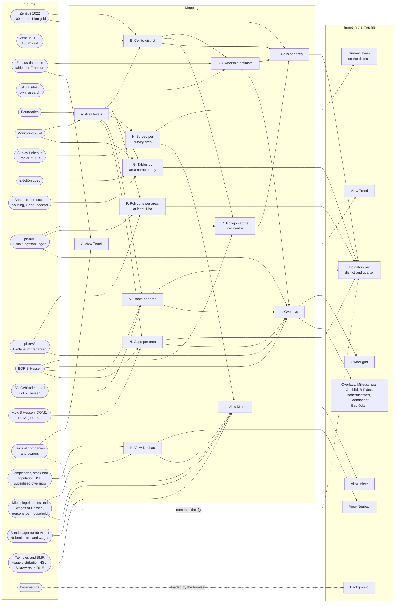

# Architecture

How the repo is built and how a number travels from its source into the map. The code and the tests are the truth.
This file names the rules they enforce. Formulas stand in the README of each use case.

## Layout

| Folder | Holds |
|---|---|
| `pipeline/` | The Python build. `build.py`, `config.py` and `update_sources.py` lie at the top, the code in four tiers: `engine/`, `shared/`, `use_cases/`, `map/`. |
| `web/` | The browser app of the map: template `map.html`, `map.css`, `js/`, `leaflet/`, `fonts/`. `pipeline/map/html` packs it. |
| `sources/` | All originals and our extracts, each exactly once, in folders by origin. Provenance in `sources/README.md`. |
| `reference/` | Values typed by hand: reference values of the checks, the published city values of the monitoring, the expected Milieuschutz areas, party colours. |
| `research/` | Findings by date as Markdown, `research/scripts/`, `research/results/`. The build reads nothing from here. |
| `docs/` | The living topic files (see "Docs and way of working") and the images of `README.md`. |
| `tests/` | pytest. It mirrors `pipeline/`: one folder per package, inside the folder of its tier. `tests/browser/` checks the built map. |
| `cache/`, `interim/`, `output/` | Raw downloads, interim datasets with the check report, the map with its exports. Not in Git. |
| `golden/` | A captured build, only while a refactoring runs. Not in Git. |

- The repo is the single source. It lies on GitHub (`wohnentscheidFrankfurt/sozialraum-frankfurt`). The map goes online
  through the website (Publishing).
- `pipeline/config.py` is the only module that builds paths. Every path lies inside the repo (`tests/test_config.py`).
- Every source file the build reads has a name in `pipeline/config.py`.
- The build reads only `sources/`, `reference/` and `web/`. It never downloads.

Sources:

- A file lies in the folder of the body that published it where we fetched it. Why: the folder says where to fetch
  it again.
- Origins: `sources/zensus/` (Zensus database, grid extracts in `sources/zensus/grid/`), `sources/frankfurt/statistics/`
  (Bürgeramt, Statistik und Wahlen), `sources/frankfurt/parlis/` (reports and answers of the Magistrat),
  `sources/frankfurt/geodata/` (WFS of the city), `sources/frankfurt/offices/` (other offices, Wahlamt, Amtsblatt),
  `sources/hessen/statistics/` (HSL), `sources/hessen/boris/`, `sources/hessen/lod2/` and `sources/hessen/alkis/`
  (HVBG), `sources/regionalstatistik/`, `sources/arbeitsagentur/` (Bundesagentur für Arbeit), `sources/companies/`
  (companies and press), `sources/other/`.
- File names stay as the publisher gave them. Our extracts lie next to their original. `sources/README.md` says how
  each was made.
- `tests/test_doc_paths.py` and `tests/test_sources_folder.py` enforce the folder rules. Folder names are lower-case
  ASCII. Every folder with files has a section in `sources/README.md`. No file exists twice. Every file is named in
  `pipeline/config.py` or by name in `sources/README.md`. `sources/` itself holds only `README.md` and `fetched.csv`.
- A list of links without files does not go into the repo. A source without a file is named only where a number or
  a finding cites it, with its title.
- `pipeline/update_sources.py` runs by hand, never as a step. It downloads `DOWNLOADS` of the config into `cache/`
  (`--refresh` downloads again). It writes into `sources/`: the Frankfurt extracts of the Zensus grids, unchanged
  copies of the votemanager election files and the planAS WFS layers, the BORIS pages, `values_2026.csv` (the
  BORIS values of 1.1.2026 per zone, from the WMS), the two extracts of the LoD2 building model (`update_lod2`: it
  asks the REST API of the HVBG for the package, downloads it into `cache/lod2/` and reads it with
  `shared/readers/citygml.py`; the gzip header holds no time, so a rerun gives the same bytes), the three ALKIS
  extracts and the cover classes of the building gap candidates (`update_alkis`: packages of ALKIS, DOM1 and DGM1 in
  `cache/alkis/`, `cache/dom/`, `cache/dgm/`, orthophotos in `cache/dop/`; output in `sources/hessen/alkis/`)
  and the long CSV of the tables `ZENSUS_TABLES` and `REGIONAL_TABLES` (Zensus database and Regionaldatenbank;
  structure and answer of each table in `cache/tables/`).
- It writes file, URL and download date to `sources/fetched.csv`. The oldest date of the planAS files is the „Abruf“
  of the map (`fetch_date` in `pipeline/engine/download.py`).
- frankfurt.de blocks automatic requests. Its files are downloaded by hand.

## Steps, store and datasets

`STEPS` in `pipeline/build.py` lists the steps in their order:

| Step | Package | Makes |
|---|---|---|
| `zensus` | `shared/zensus` | `cells_2022`: every cell with district, quarter and the `edge` flag |
| `zensus_2011` | `shared/zensus` | `cells_2011_dwellings`, `cells_2011_buildings` (inner cells of 2022) |
| `ownership_cells` | use case | `ownership_cells` (dwellings per ownership type and cell), `ownership_grid_cells` |
| `public_housing`, `coops` | use cases | `public_housing_quarters`, `coops_quarters` (working data) |
| `ownership_shares` | use case | the six owner-group shares, `ownership_ranges`, `ownership_calc_examples` |
| `ownership_history`, `new_construction` | use cases | the data of the views Trend and Neubau (`*_view`) |
| `monitoring` … `construction_year` | use cases | area tables, city values, overlays, worked examples; `rent_burden` (after `survey`) the data of the view Miete (`rent_burden_view`) |
| `flat_roofs` | use case | `flat_roofs_by_district`, `flat_roofs_by_quarter`, `flat_roofs_city`, `flat_roofs_overlays`, `flat_roofs_calc_examples`, `flat_roofs_checks` (no other step needed) |
| `building_gaps` | use case | `building_gaps_by_district`, `building_gaps_by_quarter`, `building_gaps_city`, `building_gaps_overlays`, `building_gaps_calc_examples`, `building_gaps_checks` (no other step needed) |
| `assembly` | `map/assembly` | `indicators_districts`, `indicators_quarters`, `city_values`, `map_catalog` |
| `candidates` | use case | `candidates_reference` for `tests/browser/desktop/candidates.spec.mjs` |
| `checks` | `map/checks` | `check_report` |
| `map` | `map/html` | the map and `output/data/` (no dataset) |

- A `Step` (`pipeline/engine/steps.py`) has a name, `run(ctx)`, the datasets it `needs` and those it `makes`.
- `check_order` runs before the first step. It stops on a need that no earlier step makes, on a dataset made twice
  and on a step name used twice.
- `Context` carries the store, the config module and the log. Steps reach paths only through `ctx.config`.
- `pipeline/engine/datasets.py` declares every interim dataset as `Dataset(name, kind, keys)`. Kinds are csv, json
  and md. `keys` are columns read as text, so „010“ stays „010“. Sources and reference files are not datasets.
- `Store` (`pipeline/engine/store.py`) reads and writes datasets in `interim/`. A missing dataset raises an error that
  names the step to run first.
- Steps exchange data only through the store. Only the step `map` writes outside `interim/`.
- The store parses floats exactly (`float_precision="round_trip"`). A step uses its frame in memory and never reads
  back what it just wrote. Why: the default parser can differ in the last bit, and a read-back then moves values.
- A threshold on a sum of estimates compares the rounded sum (`THRESHOLD_DECIMALS`). Why: float noise must not
  decide whether a cell shows.
- Area tables and city values keep 8 decimals (`STORED_DECIMALS` in `pipeline/shared/core/stats.py`). The browser
  rounds once, when it shows a value. Why: rounding twice can change the last shown digit.
- The name ending decides which list a dataset joins: `_by_district`, `_by_quarter`, `_city`, `_checks`.
  `ending(suffix)` collects them in the order of declaration. That order is the column order of the joined tables,
  the row order of `city_values.csv` and the order of the checks.
- `--step NAME` runs one step on the interim data of earlier runs. There is no cache between `sources/` and the
  steps. The step `zensus` reads the grid extracts every time.

## Module kinds and dependency rule

The folder of a module shows its tier. `tests/test_architecture.py` enforces this section.

| Tier | Packages | May import from `pipeline` |
|---|---|---|
| `engine/` | one package: `steps.py`, `store.py`, `datasets.py`, `download.py` | `engine/` |
| `shared/` | `core/`, `readers/` (GML, PDF, HTML, JSON-stat, reference files), `zensus/`, `geography/` | `engine/`, `shared/` |
| `use_cases/` | the 18 use cases | `engine/`, `shared/`; of another use case only `model` and `catalog` |
| `map/` | `assembly/`, `checks/`, `html/` | `engine/`, `shared/`, `map/`; of a use case only `model` and `catalog` |

- The top of `pipeline/` holds only `build.py`, `config.py`, `update_sources.py` and the four tiers.
  The tier folders hold only packages. Every folder of `pipeline/` is a package.
- No tier imports `config`. `config.py` imports nothing from `pipeline`.
- `build.py` imports every step. Every `step.py` of a package has its steps in `STEPS` (`tests/test_build.py`).
- `build.py` never imports `update_sources.py`. Why: it runs by hand and downloads.
- `update_sources.py` imports only `config`, `engine/download.py`,
  `shared/zensus/sources.py`, `shared/readers/gml.py` (the inner point of each BORIS zone),
  `shared/readers/jsonstat.py` (the long CSV of each database table) and `shared/readers/citygml.py` (the parts of
  each LoD2 building), `shared/readers/nas.py` (the ALKIS extracts) and `use_cases/building_gaps/sources.py`.
  The last one is the only import of a use case. Why: `update_alkis` measures the cover classes of the geometry
  candidates (height model and orthophoto) once, because those inputs (several GB) do not go into `sources/`.
- One import crosses the tier table: `engine/steps.py` imports `Check` from `shared/core/checks.py`.
  `TIER_EXCEPTIONS` in `tests/test_architecture.py` names it with its reason.
- `pipeline/` imports only absolute names (`from pipeline.shared.core import stats`). Identifiers are English.
- Only `config.py` builds paths from the home folder. The test scans `pipeline/` and `research/scripts/`.

| Kind | Files | May import | Does |
|---|---|---|---|
| pure | `model.py`, `catalog.py`, `checks.py`, all of `shared/core/` | standard library without I/O modules, numpy, pandas, shapely, pyproj, `shared/core`, any `model` or `catalog` | computes; no `open()`, no read or write call |
| sources | `sources.py`, `shared/zensus/tables.py` | `shared/core`, `shared/readers`, `engine/download.py`, the `model` of its own package | parses external formats; the only place with source vocabulary |
| infra | `shared/readers/*` | `shared/core`, `shared/readers` | GML, PDF, HTML and reference files; JSON-stat answers into long CSV text |
| infra | `engine/download.py` | nothing from `pipeline` (the engine tier) | downloads, fetch date |
| step | `step.py`, `shared/zensus/cells.py` | what its tier allows, but no `step` of another package | I/O through the store |

- `shared/zensus/cells.py` holds `inner_cells`, the cells of 2022 without edge cells, read through the store.
- `shared/core/city_values.py` holds the format of the city values. `assembly` writes the table. `candidates` and
  `map/html` read it.
- The packages of `shared/` and `map/` hold no formula of an indicator.
- A use case reads tables of another use case only in these pairs: `ownership_shares` reads `ownership_cells`,
  `public_housing` and `coops`; `coops` reads `ownership_cells`; `rent_burden` reads `new_construction` and `survey`
  (`TABLE_READS`).

## Use-case packages

One package per chapter of the map: `ownership_cells`, `public_housing`, `coops`, `ownership_shares`,
`ownership_history`, `new_construction`, `monitoring`, `survey`, `rent_burden`, `social_housing`, `housing`,
`construction_year`, `land`, `flat_roofs`, `building_gaps`, `protection`, `election`, `candidates`.

```
pipeline/use_cases/<use case>/
  README.md    the chapter: Shows, Formula, Why, Inputs, Output, Checks, Limits
  model.py     the formula; pure
  catalog.py   titles, ⓘ texts, source entries, date constants, worked examples, templates; pure
  checks.py    only with checks: checks against sources; pure, returns Check objects
  sources.py   only if the use case parses its own source files
  step.py      reads through the store, calls model and checks, writes its datasets and its check results
```

- Every use case has `README.md`, `model.py`, `step.py` and `catalog.py`. A `catalog.py` or `checks.py` that holds only
  a docstring is an error.
- The README title names the German chapter. The seven sections above are required; more may follow, for example
  „Worked example“. "Shows" names every indicator ID of `catalog.py`. "Inputs" names exactly the datasets of
  `step.needs`, plus the files. "Why" gives the reasons in short sentences. The architecture test checks all three.
- `catalog.py` declares the indicators as `Indicator` and the sources as `Source` (`pipeline/shared/core/indicator.py`).
  A date that several texts name stands once as a constant (`SH_AS_OF`, `BORIS_AS_OF`, `ELECTION_DAY`).
- `pipeline/map/assembly/catalog.py` holds the order of the layers (`LAYER_ORDER`) and of the sources
  (`SOURCE_ORDER`): one order for all languages. Assembly builds the catalog per language and writes `map_catalog`
  (German) and `map_catalog.<lang>` (others). The area tables are joined once, German; the text column `*_SHARED`
  of `monitoring_by_district` comes per language from `monitoring_by_district.<lang>`.
  The rules for every text of the catalog stand in `docs/texts.md`.
- A package writes `<package>_by_district` and/or `<package>_by_quarter` (one row per area, key `id`) and
  `<package>_city` (rows `indicator`, `value`, `kind`). The kind is `computed` or `published`. Working data stay in
  datasets of their own.
- Every step with checks writes `<package>_checks`.
- Indicator IDs are unique over all packages.
- `OWN_PUBLIC` and `OWN_COOP` are declared in `public_housing` and `coops`. Their values reach the map through
  `ownership_shares`, which writes all six owner-group shares.

## Data flow

Area levels:

- District (Stadtbezirk): 114 analysis units of the city's monitoring. Some join several statistical districts.
- Quarter (Stadtteil): 45 areas. Sachsenhausen-Süd and Flughafen count as one, as in the election results.
- Survey area (Umfragebezirk): 13 unions of districts. No map level; survey values show on the districts.
- Cell: a 100 m cell of the Zensus grid. An edge cell lies outside all districts but within 71 m of the city.

The path of a value is the same in every use case:

1. `sources.py` of the use case parses its files. Zensus grids are parsed in `shared/zensus/sources.py`, Zensus
   tables in `shared/zensus/tables.py`, the boundaries in `shared/geography/sources.py`.
2. `model.py` computes the value per area and for the city. It is pure.
3. `step.py` writes the area tables and the city file to the store.
4. `assembly` joins all area tables per level into `indicators_districts` and `indicators_quarters`. It adds only
   `POP` (residents of the inner cells) and the flag `small`. It collects all city files into `city_values`.
5. `assembly` writes `map_catalog`: indicators, overlays and sources with finished texts and colours.
6. `map` puts the tables, the overlays, the views and `map_catalog` into the HTML file.

`assembly` stops on a column from two area tables, on a duplicate area id, on a city value from two files and on a
table that already has `small`. A district is small if the grid or the monitoring counts under 1,000 residents
(`SMALL_POP` in `pipeline/shared/geography/model.py`).

`assembly` also fills the placeholders `{fetch_date}`, `{range_<ID>}` and `{high_<ID>}` (`fill` in
`pipeline/shared/core/indicator.py`). It merges the four `*_calc_examples` datasets into `Indicator.calc_example`.
The colours of each ramp come from `pipeline/shared/core/colours.py`.

Each source has its own shape: values per grid cell, polygons, values per named area, one value per year. Each shape
needs its own mapping. Read the diagram from left to right; the letters are the mappings below.



Sources and their paths:

| Source | Folder | Path | Package | In the map |
|---|---|---|---|---|
| Zensus 2022, 100 m grid | `sources/zensus/grid/` | B, C, D, E | `zensus` and the cell-based use cases | residents, renters, rent, vacancy, owner groups, owner grid |
| Zensus 2022, 1 km grid of the vacancy rates | `sources/zensus/grid/` | E | `housing` | fills the „–“ cells of vacancy |
| Zensus 2011, 100 m grid | `sources/zensus/grid/` | B, C, E | `zensus_2011`, `ownership_cells`, `public_housing`, `coops`, `construction_year` | owner groups, Altbau vor 1919, Nachkriegsbau |
| Zensus database, tables for Frankfurt 2011 and 2022 | `sources/zensus/` | C, J, checks | the ownership use cases, `housing`, `construction_year` | factors of the estimate, view Trend, checks |
| Stadtbezirke, Stadtteile; monitoring table | `sources/frankfurt/geodata/`, `sources/frankfurt/offices/` | A | `shared/geography` | the areas |
| Monitoring 2024 | `sources/frankfurt/offices/`, `reference/` | A, G | `monitoring` | Mindestsicherung, Arbeitslosendichte, Benachteiligungsindex |
| Survey „Leben in Frankfurt 2025“, report 2024 and microdata of both years | `sources/frankfurt/statistics/` | H, L | `survey`, `rent_burden` | Mietbelastungsquote with its breakdown by income, Wohnviertel vermissen; tenants by income group in the view Miete |
| Stadtverordnetenwahl 2026 (votemanager, Amtsblatt) | `sources/frankfurt/offices/` | G | `election` | Stärkste Liste, Wahlbeteiligung, list shares |
| Annual report „Kommunale Wohnraumversorgung“; Gebäudedatei | `sources/frankfurt/parlis/`, `sources/frankfurt/statistics/` | G | `social_housing` | Sozialwohnungen |
| planAS Erhaltungssatzungen | `sources/frankfurt/geodata/` | D, F, I | `protection` | Milieuschutz coverage and names; overlays Milieuschutz and Ortsbild |
| planAS B-Pläne im Verfahren | `sources/frankfurt/geodata/` | F, I | `land` | B-Plan im Verfahren, overlay |
| BORIS Hessen | `sources/hessen/boris/` | D, I | `land` | Bodenrichtwert, overlay |
| 3D-Gebäudemodell LoD2 Hessen (parts, Gemarkung counts); BORIS zones; synopsis of the Hessische Bauordnung, Baupaket I (check of the wall strip) | `sources/hessen/lod2/`, `sources/hessen/boris/`, `sources/other/` | I, M | `flat_roofs` | Niedrige Flachdächer, overlay |
| ALKIS Hessen (parcels, buildings, land use); height models DOM1 and DGM1 and orthophoto DOP20 (cover of the gaps); BORIS zones; hand verdicts and suitability examples | `sources/hessen/alkis/`, `sources/hessen/boris/`, `reference/` | I, N | `building_gaps` | Baulücken, overlay |
| ABG sites (own research) | `sources/other/` | C | `public_housing` | ABG and Nassauische Heimstätte |
| Texts of companies and owners | `sources/companies/`, `sources/frankfurt/parlis/`, `sources/other/` | J; names in the ⓘ (dotted), checks | `ownership_shares`, `ownership_history` | names in the ⓘ and in the view Trend |
| Completions, dwelling stock and population (Regionaldatenbank, HSL); subsidised dwellings (PARLIS) | `sources/regionalstatistik/`, `sources/hessen/statistics/`, `sources/frankfurt/parlis/` | K | `new_construction` | view Neubau |
| Mietspiegel (reports and brochures 2018 to 2026), Verbraucherpreisindex and Nominallohnindex of Hessen (HSL), persons per household (Melderegister) | `sources/frankfurt/offices/`, `sources/hessen/statistics/`, `sources/frankfurt/statistics/` | K, L | `new_construction`, `rent_burden` | block of rents in the view Neubau; rents and the Betriebskostenspiegel of the view Miete |
| Kosten der Unterkunft (SGB II) and Entgeltstatistik (Bundesagentur für Arbeit) | `sources/arbeitsagentur/` | L | `rent_burden` | Nebenkosten and median wage of the view Miete |
| Verdienstverteilung in Hessen 2025 (HSL N I 9 j/25) | `sources/hessen/statistics/` | L, checks | `rent_burden` | where the pension ceiling lies (Regel of the ⓘ) |
| Wohnungsmarktbericht 2019/2020 (Mikrozensus 2018) | `sources/frankfurt/offices/` | L | `rent_burden` | comparison in the ⓘ of the tenants by income group |
| Lohnsteuerrechner and Einkommensteuerrechner of the BMF | `reference/` | checks | `rent_burden` | check of the net wage |
| Background map | basemap.de | – | the browser | grey tiles, loaded live |

Mappings:

- **A. Area levels** (`shared/geography`). The monitoring table names the unit („Einheit“) of each statistical
  district. Their shapes are merged into the 114 districts. A district takes the quarter and the survey area of its
  statistical district with the most residents. The quarter boundaries give the 45 quarters (`map_quarter_name`).
- **B. Cell to district** (step `zensus`). The cell id gives the centre. It is converted from EPSG:3035 to EPSG:25832.
  The district that contains the centre takes the cell; on a border the first district wins. The quarter follows the
  district. Edge cells stay in `cells_2022` for the vacancy fill; `inner_cells` drops them. The 2011 grid uses the same
  cell ids, so `zensus_2011` keeps the inner cells of 2022.
- **C. Ownership estimate.** `ownership_cells` turns buildings per ownership type into dwellings per cell.
  `public_housing` estimates ABG and Nassauische Heimstätte per quarter, `coops` the cooperatives per quarter.
  `ownership_shares` divides all six owner groups by all dwellings of the quarter. Shares exist only per quarter.
  Formulas, ranges and limits: the READMEs of the four packages.
- **D. Polygon at the cell centre** (`land`, `protection`). A cell takes the land value of its zone, or the flag
  „inside a Milieuschutz statute in force“.
- **E. Cells per area.** Every indicator sums or weights its inner cells by its own rule (the `model.py` of its
  package). The city value applies the same rule to all inner cells.
- **F. Polygons per area** (`land`, `protection`). A statute or plan counts for an area if it covers at least 1 ha
  of it (`MIN_OVERLAP_M2`). The profile names them.
- **G. Tables by area name or key** (`monitoring`, `election`, `social_housing`). A source row per statistical
  district or quarter is matched by key or name. Monitoring values reach the quarters as weighted means of their
  districts.
- **H. Survey** (`survey`). The printed classes of two figures of the report are typed in `sources.py`. Each district
  shows the class of its survey area. Quarters get no survey value. The microdata of both years give the rent burden
  per income group and survey area for the tooltip. `survey_half_widths` holds the half widths for the Unsicherheit.
  `survey_calc_examples` holds the worked example. `survey_respondents` (working data) holds the respondents of both
  years for use cases that recompute the burden with `burden_ratios`.
- **I. Overlays** (`land`, `protection`, `ownership_cells`, `flat_roofs`, `building_gaps`). Shapes are simplified
  (building gaps 0.5 m, flat roofs 1 m, statutes 2 m, plans and areas 5 m, land value zones 10 m) and converted to
  WGS84. The owner grid holds cells with at least 10 estimated dwellings as integer rows. Why: the file stays under its
  size limit.
- **J. View Trend** (`ownership_history`). Zensus database tables for Frankfurt, 2011 and 2022 on the territory of
  2022, no areas. `shared/zensus/tables.py` reads them. The step writes `ownership_history_view` with every share,
  colour and text finished. The payload key `history` carries it to `web/js/06_history.js`, which only draws. Each
  chart carries its `link`, the slug of a direct link (`docs/design.md`, Direct links).
- **K. View Neubau** (`new_construction`). Completions per year from the Regionaldatenbank and the HSL report,
  subsidised dwellings from reports and answers of the Magistrat. The stock on 31.12. from the Regionaldatenbank
  (2011–2024) and the HSL report F I 1 j/25 (2025). The population (Hauptwohnsitz) on 31.12. from the
  Regionaldatenbank table 12411-01-01-4 (2011–2025); the report A I 2 of the 2nd half of 2025 checks 2025. The
  reports F I 1 j/22 and A I 2 (2nd half of 2022) give 31.12.2022 on the old base (Zensus 2011) for the chained
  growths and the hollow dots. The block of rents adds four sources. `sources.py` reads the mean net rent per m² of the
  new and of the older contracts and the survey month from the Mietspiegel PDFs (pinned phrases in `RENT_SOURCES`), the
  Verbraucherpreisindex from table 3 of the HSL report M I 2 j/25, the Nominallohnindex from the HSL press table
  (xlsx) and the persons per household from the Melderegister CSV. They stop on format drift. `rents_table` joins them
  with the stock and the population to the index 2017 = 100. The block ends at `RENT_TO`, the last survey year; the
  columns and the stock run to `LAST_YEAR`, so a year without a survey does not stop the step. The footer lists the
  sources of the block (`SOURCES` of `catalog.py`). The step writes `new_construction`,
  `new_construction_stock` (stock and population per year), `new_construction_rents` (the index per year) and
  `new_construction_view`; the view holds the block of rents under the key `rents`, with every value, label, axis and
  tooltip finished by `rents_view`. The chart of completions and the block of rents each carry their `link`, the slug
  of a direct link (`docs/design.md`, Direct links). The payload key `new_construction` carries it to
  `web/js/08_new_construction.js`, which only draws.
- **L. View Miete** (`rent_burden`). Figure S1 is a Rechenbeispiel: the warm rent of one flat of 55 m² as a share of
  the net wage of three model persons, per survey year of the Mietspiegel and per group of contracts; the figure shows
  the latest year (`RENT_TO`) as wage bars. The net cold
  rents come from `new_construction_rents`. The Nebenkosten are those of the Kosten der Unterkunft of the BA, June of
  each survey year. The median wage by Wohnort comes from the Entgeltstatistik. `sources.py` holds the tax and
  contribution rules of each survey day with their law (`WAGE_RULES`, `MINDESTLOHN`) and the Betriebskostenspiegel of
  the Mietspiegel reports for the sensitivity (`MIETSPIEGEL_COSTS`). `model.py` computes the net wage by the
  Programmablaufplan of the BMF. Figure S2 recomputes the burden of the tenants of `survey_respondents` with
  `burden_ratios` of `survey` and splits it by income group and burden class. The Mikrozensus 2018 of the
  Wohnungsmarktbericht 2019/2020 stands in the ⓘ only. The step writes `rent_burden_wage`, `rent_burden_groups` and
  `rent_burden_view`; the view holds every value, label, axis and tooltip, finished by `wage_view` and `bars_view`.
  Each figure carries its `link` (`docs/design.md`, Direct links). The payload key `rent_burden` carries the view to
  `web/js/10_rent_burden.js`, which only draws.
- **M. Roofs per area** (`flat_roofs`). Each roof candidate takes the district and the quarter that contain its
  representative point. A roof in no district drops out. The area of a district or quarter is the sum of its counted
  roofs, each without its wall strip (2.5 m in front of a wall more than 3 m higher, `WALL_GAP_M`). Why: a building
  belongs to one area, and the sums close.
- **N. Gaps per area** (`building_gaps`). The step reruns the geometry rule on the three ALKIS extracts, then the zone
  rule of BORIS and the cover classes of `building_gaps_cover.csv`, then the hand verdicts of `reference/`. Height
  model and orthophoto enter only through that cover extract (`update_alkis`). Each gap takes the district and the
  quarter that contain its representative point. The area of an area is the sum of its counted gaps. Why: a parcel
  belongs to one area, and the sums close.

Rules of the numbers (published values first, Zensus notation, estimates): `docs/data-rules.md`.

## Checks

- A check is a `Check` (`pipeline/shared/core/checks.py`) with name, status and text. The status is `OK`, `WARN` or
  `FAIL`.
- A check lives in the package whose numbers it checks. `checks.py` is pure and returns checks. The step writes them
  with `write_checks` to `<package>_checks`.
- `assembly` checks the residents per district and quarter against the monitoring, and the ⓘ protocols of the whole
  catalog. The step `zensus` checks the grid sums.
- Reference values come from `reference/`. A `source` column there stays German.
- The step `checks` reads every `_checks` dataset (`CHECK_RESULTS`) and writes `interim/check_report.md`. The report
  lists FAIL, then WARN, then OK. Sections on unassigned dwellings, small districts, low coverage and plausibility
  follow.
- After the report is written, one `FAIL` stops the build. The step `checks` runs before `map`, so no new map is
  written.
- A `WARN` does not stop the map build. The report lists every WARN row. The website build still refuses the map
  while one stands (see Publishing).
- `--step checks` only collects. After a change in `reference/`, run the step that writes the check first.
- `sources.py` detects format drift: a missing column or row, a sum that does not add up, a new annual report. It
  raises `ValueError` with the file and what to change. This stops the build at once, without a report row.
- Thresholds and tolerances of the checks: `docs/data-rules.md`.
- Outside the build, the browser tests check the built map (Browser tests).
- `tests/use_cases/rent_burden/test_step.py` runs the step on the real sources and reads its inputs from `interim/` of
  a build (`new_construction_rents`, `survey_respondents`, `survey_city`). A missing dataset fails the test and names
  the step to run first (`--step survey`, or the full build on a fresh checkout).

## The map file

- One HTML file, `output/sozialraum-frankfurt.html` (`MAP_NAME`). `pipeline/map/html` fills the six markers of
  `web/map.html`: `/*__LEAFLET_CSS__*/`, `/*__FONTS__*/`, `/*__MAP_CSS__*/`, `/*__DATA__*/`, `/*__LEAFLET_JS__*/`,
  `/*__MAP_JS__*/`. A missing or repeated marker stops the step.
- The JS files of `web/js/` are joined in the order of their names. The fonts are embedded as base64.
- The data is one JSON object in `<script type="application/json" id="data">`. `json_for_html` escapes „<“ and
  rejects NaN.
- Payload keys: `catalog`, `overlays`, `sources` (from `map_catalog`), `districts`, `quarters`, `city_values`,
  `lists`, `election_layers`, `templates`, `custom_note`, the overlay shapes (among them `flat_roofs`),
  `grid_groups`, `grid_cells`, `grid_dative`, `history`, `new_construction`, `rent_burden`,
  `ramp_teal`, `hit_border`, `created`.
- The area properties are a whitelist. `browser_properties` in `pipeline/map/html/model.py` keeps what the browser
  reads. A test scans `web/js` for every `p.<name>`. A new property must be in the catalog or in
  `BROWSER_EXTRA_PROPERTIES`.
- The file stays under `MAX_BYTES` (5 MiB). Above it the step stops and lists the size of each payload key.
- The file works on its own. Only the basemap.de tiles load from the network. The browser tests block every request
  except `file:`.
- A cover note stands as an HTML comment right after the doctype. It is German and demands nothing
  (`docs/texts.md`, Neutrality). It must not contain `--`, else the step stops. Its caveats mirror the help.
- The years of the cover note come from catalog constants where they exist. The years of Zensus, monitoring,
  survey and the 3D building model are typed in `cover_note` and must follow new data.
- The map demands nothing (`docs/texts.md`, Neutrality).
- The map is public and may be indexed. The template has no `robots` meta tag.
- The exports in `output/data/` stay local: `indicators_districts.csv`, `indicators_quarters.csv` and two GeoJSON
  files. They keep every column. They round each `<group>_DWELLINGS` column and its ends to 50. The HTML keeps the
  values unrounded; the browser rounds.
- Ids of the map links: a map link carries layer ids (`layer=`), overlay names (`overlays=`) and the levels
  (`quarter`, `district`). They are addresses. Renaming one breaks every shared link. So they never change.
  `test_ids_of_map_links_never_change` in `tests/map/html/test_web.py` pins the layer ids and the overlay names.
  The list shares of the election are built from data and are not pinned. The levels live in `web/js`.
- UI rules: `docs/design.md`. Text rules: `docs/texts.md`.

## Browser tests

- `tests/browser/` checks the built map with Playwright Test. `@playwright/test` is the only dependency of
  `tests/browser/package.json`. The build must exist: the map, `interim/candidates_reference.csv` and
  `interim/protection_by_district.csv`. `desktop/profile.spec.mjs` reads the last one from the folder of
  `CANDIDATES_CSV`.
- Run: `(cd tests/browser && npx playwright test)`. More commands stand in `CLAUDE.md`.
- `tests/browser/playwright.config.mjs` sets `fullyParallel`, `retries: 0` and `forbidOnly`. Why no retries: a flake is
  fixed at its cause.
- A failed test keeps its trace under `output/playwright/results`. The HTML report goes to `output/playwright/report`.
- Paths come from env, relative to the repo root (`tests/browser/helpers/common.mjs`): `MAP_HTML`, `CANDIDATES_CSV`,
  `SCREENS`. Their defaults are `output/sozialraum-frankfurt.html`, `interim/candidates_reference.csv` and
  `output/screens`.

Each project is one window:

| Project | Browser | Window | Files |
|---|---|---|---|
| `desktop-chrome` | system Chrome | 1400 × 900 | `desktop/`, `frame.spec.mjs` |
| `webkit-iphone` | Playwright WebKit | iPhone 15 | `mobile/phone.spec.mjs`, `mobile/links.spec.mjs`, `frame.spec.mjs` |
| `webkit-iphone-se` | Playwright WebKit | iPhone SE | `mobile/phone.spec.mjs` |
| `webkit-iphone-landscape` | Playwright WebKit | iPhone 15 across | `mobile/medium.spec.mjs` |
| `chrome-390` | system Chrome, touch | 390 × 844, scale 2 | `mobile/phone.spec.mjs` |
| `chrome-768` | system Chrome, touch | 768 × 1024 | `mobile/medium.spec.mjs` |

- A check that holds for one window only asks for the project name.
- Each chart view has its own desktop file: `tests/browser/desktop/trend.spec.mjs`,
  `tests/browser/desktop/new-construction.spec.mjs`, `tests/browser/desktop/rent-burden.spec.mjs`.
  `tests/browser/helpers/charts.mjs` holds the chart checks that the desktop and the mobile files share.
- `tests/browser/fixtures.mjs` is the frame. Every test imports `test` and `expect` from it.
- Its guard lets only `file:`, `data:` and `blob:` load and aborts every other request.
- A console error or a page error fails the test at its end. The message Chrome logs for an aborted load does not count.
- `mapPage` gives the map ready: `APP.ready`, the fonts loaded, the frames settled. The option `fragment` opens a
  direct link.
- `check(condition, message)` is a soft assertion. The test goes on and reports every failed check.
- `saveScreenshot` writes a file under `SCREENS`. Screenshots are files to look at, not assertions.
- `tests/browser/frame.spec.mjs` proves the frame: a console error, a page error and a request outside `file:` each
  fail a test.
- Every test has its own page. A test that needs a state sets it up itself.
- A test waits on a condition (`waitForFunction`) or on `settle` (two frames and the time of a Leaflet animation).
  A fixed pause stands only where a check proves that something does not happen later (`mobile/phone.spec.mjs`:
  the tooltip stays). No test gets a longer timeout.
- Shared helpers lie in `tests/browser/helpers/`. Helpers of one area have their own module there.
- A browser test checks rules, numbers, placeholders and structure. It never pins the wording of a map text.
- Where a check needs a text, it takes it from the page: the payload, the catalog or `APP`.
- A test finds an element by id, `data-*` attribute or role, never by its visible text.
- `tests/test_text_copies.py` also reads the literals of the browser tests (`docs/texts.md`, Where texts live).
- `tests/browser/tools/` holds three scripts that run with `node`; they are no tests. `dump_text.mjs` stores the
  visible text of fixed states. It selects by tag, visible text and the classes of Leaflet, so the dump survives
  renames. It waits until the map stands still. `readme_images.mjs` draws the images of `README.md` and loads the
  tiles from the network. `teaser_image.mjs` draws the teaser image of the website (1400x900 px at scale 2) the same way
  and exits with 1 when no tile loads.

## Publishing

- The repo lies on GitHub at `wohnentscheidFrankfurt/sozialraum-frankfurt`, with `sources/` and `research/`. It is
  public. Its commits use the noreply address of `wohnentscheidFrankfurt`.
  Licences: `README.md`.
- The map is online at https://wohnentscheid-frankfurt.de/sozialraum-frankfurt/. It is public and may be indexed.
- The Astro integration of the website (`integrations/map.mjs`) copies `output/sozialraum-frankfurt.html` during the
  website build. The map build copies nothing outside this repo.
- The website build refuses the map if the check report has a WARN or FAIL row, if the repo is dirty, or if the map
  file is older than HEAD. Commit, then rebuild.
- The website proxies the background tiles under `/sozialraum-frankfurt/kacheln/{z}/{y}/{x}.png`. Over http(s) the map
  loads them from there (`APP.tileUrl` in `web/js/01_base.js`). From `file:` it loads them directly from basemap.de.

## Docs and way of working

The living docs describe the project as it is now. Git history keeps the past. The history before 16.11.2026 lies
only in a local archive clone.

| File | Holds |
|---|---|
| `CLAUDE.md` | Rules for Claude, commands, layout in short |
| `README.md` | What the map shows, with one image per view; how to build |
| `docs/architecture.md` | Code structure, data flow, checks, the map file, browser tests, publishing, docs |
| `docs/texts.md` | Rules for every text of the map, the catalog and the ⓘ protocol |
| `docs/design.md` | Rules for the UI in `web/` |
| `docs/data-rules.md` | Cross-cutting rules for numbers and the thresholds of the checks |
| `docs/glossary.md` | German terms and their English names |
| `pipeline/use_cases/<use case>/README.md` | Formula, reasons, inputs, checks and limits of one use case |
| `sources/README.md` | Provenance of every source file |
| `research/README.md` | Index of the findings |

- A topic file states the current rule. It names no dates, no history and no decision IDs.
- A rule is one short sentence. A short „Why:“ follows only when the reason matters for later choices.
- A decision made in chat updates the matching topic file or README in the same commit. It gets no file of its own.
- Spec and plan of a branch are temporary files outside the repo, in the IntelliJ scratches folder of the user. Before
  the merge, what stays valid moves into a topic file or a README. After the merge, docs and code speak for themselves.
- Findings go to `research/` as Markdown, by date, at the end of a working session. Their text is not changed later.
  A finding goes into the repo only when a file outside `research/` names it, or when it records a data situation.
  A finding that no file outside `research/` names goes; Git keeps it (`research/README.md`, Keeping and removing).
- A refactoring is guarded by `tests/compare_build.py`. `capture` stores a finished build in `golden/`. Before the new
  build, `touch interim/.build-start` marks older files as stale. `compare` prints changed values (exit code 1) and
  removed or added files, columns and keys (exit code 0). `ui` compares two dumps of
  `tests/browser/tools/dump_text.mjs`. Both dumps come from the current tool.
  A changed value stops the work until the user has decided.
- `tests/test_text_copies.py` finds a test that repeats a map text: a literal of 20 or more characters with a German
  word (`docs/texts.md`, Where texts live).
- `tests/test_doc_paths.py` checks the living docs. Every repo path they name in backticks exists. No prose line is
  longer than 120 characters; tables, code blocks, headings and a line with one URL or one code span may be longer.
- It also checks every pointer „docs/<name>.md, <Section>“ in code, tests and docs: the section is a heading of that
  file. Keep such a pointer on one line.
